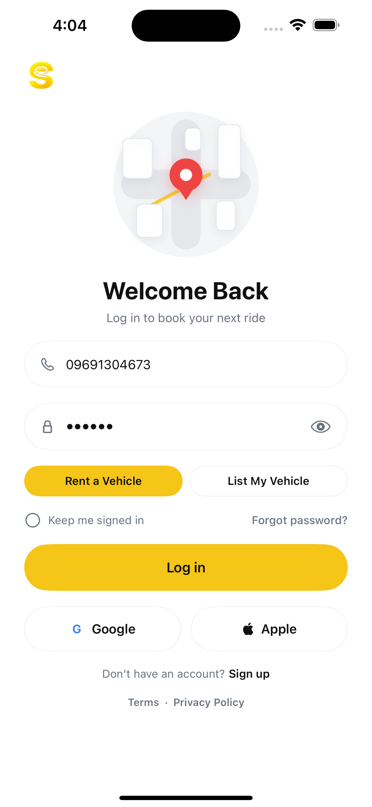
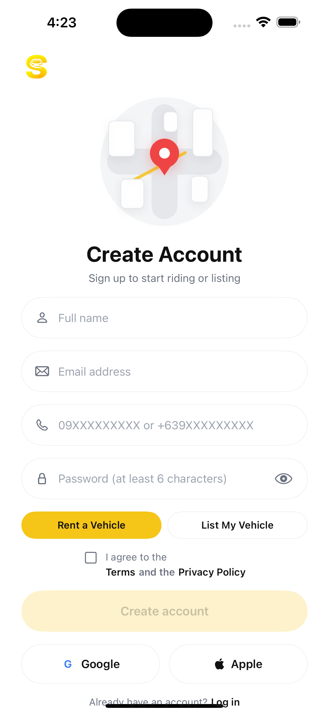
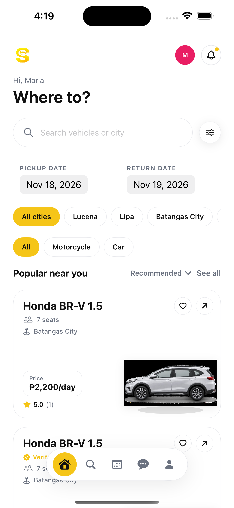
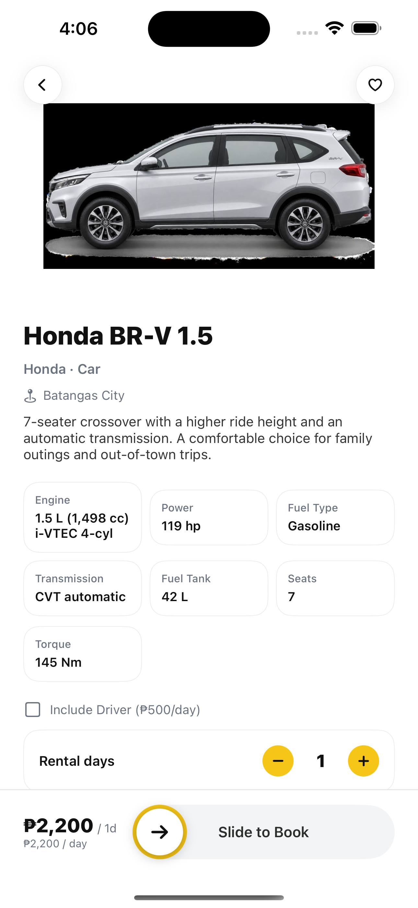
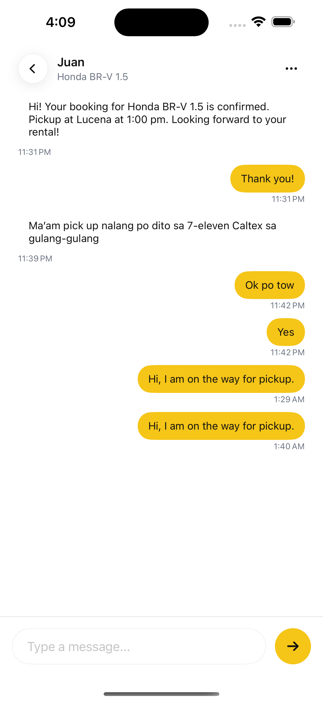
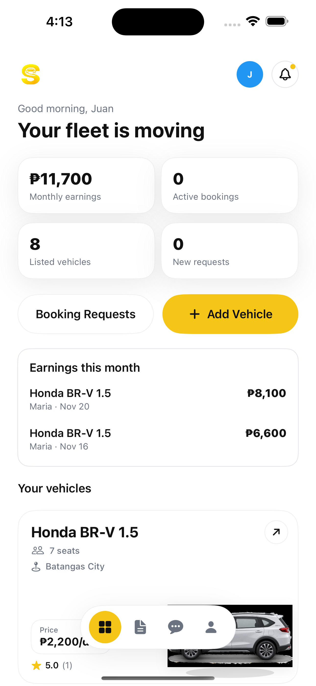
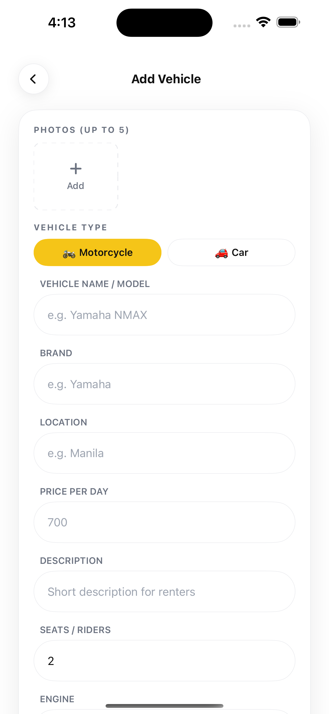
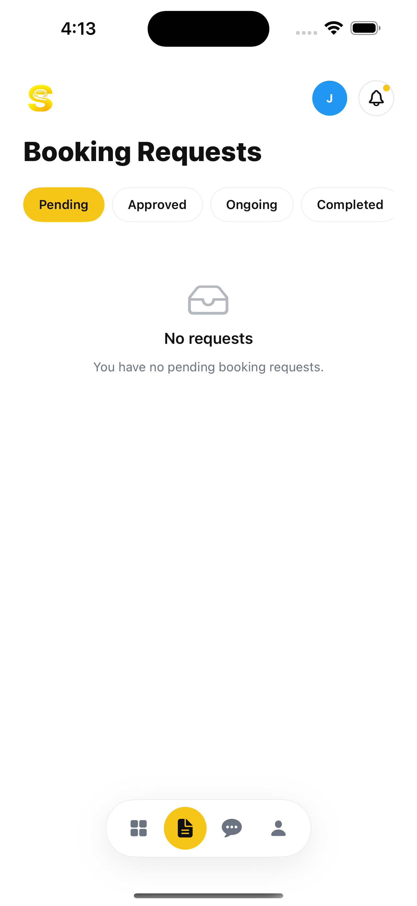

# SakayNa

SwiftUI iOS app for motorcycle and car rental in the Philippines (₱).  
Renters browse and book; owners list vehicles and manage trips. Live data uses **Firebase Auth** + **Cloud Firestore**.

## Source code

**https://github.com/Prncepe/SakayNa**

## Application overview

See [docs/APPLICATION_OVERVIEW.md](docs/APPLICATION_OVERVIEW.md).

## Screenshots

36 feature screenshots live in [`docs/screenshots/`](docs/screenshots/) (welcome → signup → renter booking/trip/chat → owner dashboard/listings/requests). Full inventory: [APPLICATION_OVERVIEW.md](docs/APPLICATION_OVERVIEW.md#screenshots).

| Screen | Preview |
|---|---|
| Welcome |  |
| Login |  |
| Signup |  |
| Renter home |  |
| Vehicle detail |  |
| Trip tracking |  |
| Chat |  |
| Owner dashboard |  |
| Add vehicle |  |
| Booking requests |  |

## Demo accounts

| Role | Phone | Password |
|---|---|---|
| Owner (Juan) | `09691304673` | `123456` |
| Renter (Maria) | `09157977535` | `123456` |

## Requirements

- Xcode 15+ / iOS 17+
- Firebase project `sakayna-5741b` (plist included)
- Publish rules from `firebase/firestore.rules`

## Build

```bash
python3 generate_xcodeproj.py
open SakayNa.xcodeproj
```

Select your Development Team under **Signing & Capabilities**, then Run on a simulator or iPhone.
